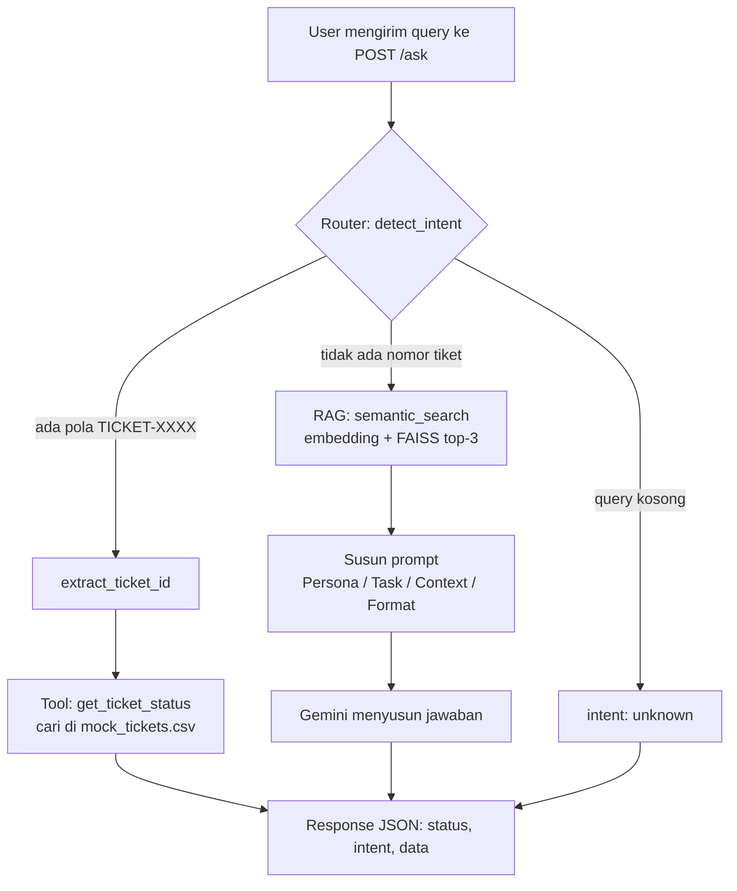

# IT Helpdesk Assistant — RAG + Mini-Agent

Assignment 4 — End-to-End RAG & AI Agent Development
AI Engineering Bootcamp, Rework Academy · Louisa

Backend API yang menjawab pertanyaan karyawan seputar kebijakan HR & IT menggunakan **RAG**, dan mengecek status tiket menggunakan **tool call**, dalam satu endpoint `/ask`. Dikemas dalam container Docker.

---

## 1. Problem Statement 

**Objective**
Membangun Prototype sebuah system yang dapat membantu Tim People dan IT dalam menghandle ratusan repetitif pertanyaan karyawan. ini dapat memberikan jam kerja yang lebih banyak di alokasikan ke pekerjaan lain, dan SLA kepada karyawan lebih cepat 

**Dua jenis permintaan yang ditangani**

| Jenis | Contoh | Ditangani oleh |
|---|---|---|
| Pertanyaan kebijakan/informasi | Bagaimana cara reset VPN ? | RAG |
| Cek status tiket spesifik | Apa Status Tiket No TICKET-0042 | Tool call |

**Batasan & asumsi**
Karena ini hanya prototype, jumlah data knowledge base terbatas (31 FAQ) dan data tiket bersifat dummy (15 tiket). Format nomor tiket diasumsikan selalu `TICKET-` + 4 angka, dan aplikasi dijalankan secara lokal (tidak di-deploy ke cloud).

---

## 2. Desain Workflow




### Kriteria intent

1. **Aturan routing.** Router mengecek query dengan urutan berikut:
   - Query kosong → intent `unknown` → sistem mengembalikan pesan error.
   - Ada pola yang cocok dengan format tiket (`TICKET-` + 4 angka) → intent `ticket_status` → dikirim ke `tools.py`.
   - Tidak ada nomor tiket → intent `faq` → dikirim ke RAG.

2. **Kenapa tiket tidak dicari pakai RAG?** RAG mencari berdasarkan kemiripan makna, sedangkan data tiket butuh kecocokan yang sama persis. Bagi RAG, `TICKET-0005` dan `TICKET-0050` terlihat hampir sama, padahal itu tiket orang yang berbeda. Karena itu tiket dicari dengan tool yang mencocokkan ID secara persis (exact match).

3. **Kenapa regex, bukan LLM?** Nomor tiket punya format tetap, jadi cukup dideteksi dari bentuknya. Regex instan, gratis, hasilnya selalu konsisten, dan tidak bergantung pada API, sehingga tidak bisa gagal karena server LLM sedang sibuk.

4. **Contoh kasus jebakan.** Query *"Bagaimana cara cek status tiket saya?"* mengandung kata "tiket", tapi tidak menyebut nomor tiket. User sedang menanyakan prosedur, bukan tiket tertentu, sehingga router mengarahkannya ke `faq` (RAG), bukan ke tool.

---

## 3. Komponen & Keputusan Teknis

| File | Tugas |
|---|---|
| `app/main.py` | Endpoint FastAPI `/ask` + error handling |
| `app/router.py` | Deteksi intent (regex) + ekstraksi `ticket_id` + routing |
| `app/rag.py` | Embedding, index FAISS, semantic search, prompt, panggil Gemini |
| `app/tools.py` | Cari status tiket di `mock_tickets.csv` |

| Keputusan | Pilihan | Alasan |
|---|---|---|
| Model embedding | `gemini-embedding-001` |  text-embedding-004 sudah discontinued |
| Teks yang di-embedding | pertanyaan + jawaban FAQ digabung |  Setiap FAQ di-embedding sebagai gabungan pertanyaan dan jawaban, supaya pencarian bisa cocok dengan kata kunci yang hanya muncul di jawaban.|
| Vector index | FAISS `IndexFlatL2`, top_k = 3 | Cukup untuk memberi Gemini konteks kalau FAQ terbaiknya meleset sedikit, tapi tidak terlalu banyak sampai Gemini terganggu informasi yang tidak relevan|
| Model penjawab | `gemini-3.1-flash-lite` | model 3.8 flash beberapa kali error 503/504, pilihan Flash-Lite untuk Helpdesk yang menjawab FAQ pendek, model cepat dan hemat quota|
| Pembangunan index | lazy loading (sekali, di pertanyaan pertama) | Pertanyaan pertama: _index masih kosong, jadi index dibangun (sekitar 20 detik).Pertanyaan kedua dan seterusnya: _index sudah terisi, jadi langsung mencari (sekitar 1 detik).|
| Timeout LLM | 30 detik | Masalahnya: tanpa timeout, aplikasi bisa menggantung tanpa batas kalau Gemini lambat atau down.Solusinya: dengan batas 30 detik, aplikasi menyerah lalu masuk ke error handling, sehingga user tetap mendapat pesan yang jelas, bukan menunggu tanpa kepastian.|

---

## 4. Struktur Project

```
assignment-helpdesk-agent-louisa/
├── app/
│   ├── main.py
│   ├── router.py
│   ├── rag.py
│   └── tools.py
├── data/
│   ├── it_helpdesk_knowledge_base.csv
│   └── mock_tickets.csv
├── Dockerfile
├── .env.example
├── .gitignore
├── requirements.txt
└── README.md
```

---

## 5. Cara Menjalankan

### Persiapan API key
```bash
cp .env.example .env
# buka .env, isi GEMINI_API_KEY dengan API key Gemini milikmu
```

### A. Lokal (tanpa Docker)
```bash
python3 -m venv venv
source venv/bin/activate          # Windows: venv\Scripts\activate
pip install -r requirements.txt
uvicorn app.main:app --reload
```
Buka **http://127.0.0.1:8000/docs**

### B. Dengan Docker
```bash
docker build -t it-helpdesk-assistant .
docker run -p 8000:8000 --env-file .env it-helpdesk-assistant
```
Buka **http://127.0.0.1:8000/docs**

API key **tidak** dibungkus di dalam image; diberikan saat container dijalankan lewat `--env-file`.

### Contoh request
```bash
curl -X POST http://127.0.0.1:8000/ask \
  -H "Content-Type: application/json" \
  -d '{"query": "berapa jatah cuti tahunan saya?"}'
```

---

## 6. Hasil Pengujian (dijalankan di dalam container Docker)

| No | Query | Intent | Komponen | Hasil | Observasi  |
|---|---|---|---|---|---|
| 1 | berapa jatah cuti tahunan saya? | `faq` | RAG | 12 hari cuti tahunan setelah masa kerja minimal 3 bulan | Router mengarah ke RAG karena tidak ada nomor tiket. Jawaban Gemini sesuai dengan FAQ no. 1.|
| 2 | bagaimana cara reset password VPN? | `faq` | RAG | Lewat portal self-service IT; hubungi IT Support jika akun terkunci | Router mengarah ke RAG karena tidak ada nomor tiket. Jawaban sesuai FAQ no. 8, dirangkai ulang oleh Gemini menjadi kalimat yang lebih natural.|
| 3 | status TICKET-0005 saya apa? | `ticket_status` | Tool | Reset password VPN gagal terus — Diproses — 2026-08-27 | Router mengarah ke tool karena ada nomor tiket. Jawaban lebih cepat karena jalur ini tidak memanggil Gemini. |
| 4 | tolong cek TICKET-9999 | `ticket_status` | Tool | Tiket tidak ditemukan (tanpa crash) | Router mengarah ke tool. Tiket tidak ada di data, tetapi aplikasi tidak crash karena ada penanganan untuk data yang tidak ditemukan. |
| 5 | siapa CEO perusahaan ini? | `faq` | RAG | Menjawab tidak memiliki informasi, menyarankan menghubungi HR | Router mengarah ke RAG karena tidak ada nomor tiket. FAISS tetap mengembalikan 3 FAQ walaupun tidak relevan, tetapi Gemini tidak mengarang jawaban karena prompt menginstruksikan untuk hanya menjawab berdasarkan Context. |

**Uji error handling:** model LLM sengaja diganti dengan nama yang tidak valid → API tetap membalas format standar `{"status": "error", "intent": "unknown", "data": "Maaf, layanan AI sedang tidak dapat merespons..."}`, sementara detail error (`400 INVALID_ARGUMENT`) hanya dicatat di log server.

**Kesimpulan:** Router mengarahkan kelima skenario ke komponen yang tepat: pertanyaan dengan nomor tiket ke tool, pertanyaan tanpa nomor tiket ke RAG. Sistem juga tidak crash saat tiket tidak ditemukan maupun saat LLM gagal merespons.
---

## 7. Keterbatasan Sistem 

1. **Pertanyaan tiket tanpa nomor.** Kalau user bertanya "tiket saya soal VPN kemarin gimana?", router mengarahkannya ke RAG karena tidak ada nomor tiket. Akibatnya, sistem tidak bisa mengecek status tiket yang dimaksud, karena RAG hanya berisi FAQ, bukan data tiket.

2. **Bergantung pada Gemini API.** Saat pengujian, model gemini-3.8-flash beberapa kali mengalami timeout dan server sibuk (error 503/504), sehingga pertanyaan kebijakan tidak bisa dijawab. Hal ini diatasi dengan error handling (user tetap mendapat pesan yang jelas) dan dengan mengganti model ke gemini-3.1-flash-lite. Jalur cek tiket tidak terdampak karena tidak memakai Gemini.

3. **Pertanyaan pertama lebih lambat.** Setiap kali server atau container baru menyala, index FAISS harus dibangun ulang (sekitar 20 detik), karena index hanya disimpan di memori dan hilang saat aplikasi berhenti.

## 8. Pengembangan Selanjutnya

1. **Router hybrid.** Regex tetap dipakai sebagai pemeriksa pertama karena cepat dan gratis. Kalau regex tidak menemukan nomor tiket, LLM dipakai sebagai cadangan untuk mendeteksi apakah user sebenarnya menanyakan tiket, lalu sistem meminta user menyebutkan nomor tiketnya.

2. **Fallback saat LLM gagal.** Kalau Gemini tidak merespons, sistem tetap mengembalikan jawaban FAQ yang paling relevan langsung dari hasil pencarian FAISS, sehingga user tetap mendapat informasi walaupun tanpa dirangkai oleh LLM.

3. **Simpan index FAISS ke file.** Index dibangun sekali saat build image dan disimpan sebagai file, sehingga tidak perlu dibangun ulang setiap kali server atau container menyala, dan pertanyaan pertama tidak lagi lambat.